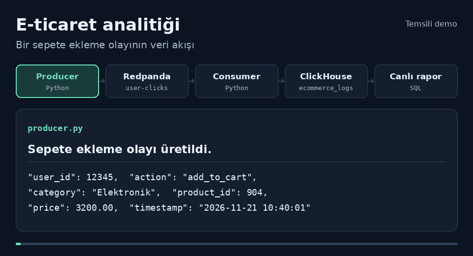
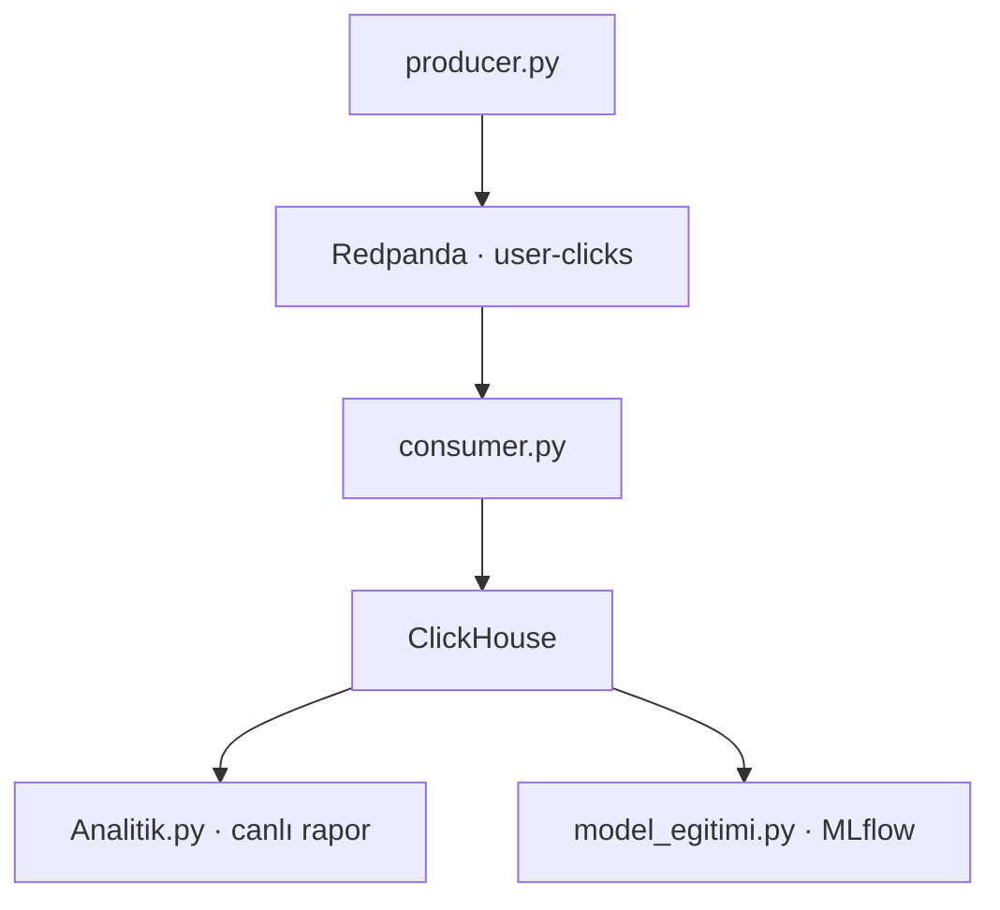

# E-Ticaret Analitiği

Sentetik e-ticaret hareketlerini gerçek zamanlı işleyen bir Python projesi. Ürün görüntüleme, tıklama ve sepete ekleme olayları Redpanda üzerinden ClickHouse'a aktarılır. ClickHouse sorguları terminalde canlı rapor üretir. Ayrı bir Random Forest denemesi MLflow ile takip edilir.

## Canlı analiz demosu

Bu 24 saniyelik temsili animasyon, bir sepete ekleme olayının Redpanda üzerinden ClickHouse'a yazılmasını ve SQL raporuna yansımasını gösterir.





## Kurulum

Python 3.12 ve Docker Compose gerekir. Komutları proje klasöründe çalıştırın.

**Windows PowerShell**

```powershell
Copy-Item .env.example .env
python -m venv .venv
.\.venv\Scripts\python.exe -m pip install -r requirements.txt
```

**Linux ve macOS**

```bash
cp .env.example .env
python3 -m venv .venv
.venv/bin/python -m pip install -r requirements.txt
```

`.env` dosyasındaki `CLICKHOUSE_PASSWORD` değerini kendi yerel parolanızla değiştirin. Docker çalışırken servisleri başlatın.

```bash
docker compose up -d
```

## Canlı akışı çalıştırma

Servisler hazır olunca aşağıdaki komutları sırayla ayrı terminallerde çalıştırın. Windows PowerShell kullanıyorsanız `python` yerine `.\.venv\Scripts\python.exe`, Linux veya macOS kullanıyorsanız `.venv/bin/python` yazın.

| Sıra | Komut | Ekranda göreceğiniz |
| --- | --- | --- |
| 1 | `python consumer.py` | ClickHouse tablosunun hazır olduğunu ve kuyruğun dinlendiğini gösteren mesaj |
| 2 | `python producer.py` | Redpanda'nın `user-clicks` kanalına gönderilen sentetik olaylar |
| 3 | `python Analitik.py` | Beş saniyede bir yenilenen rapor |

Redpanda Console'u [localhost:8080](http://localhost:8080) adresinden açıp `user-clicks` kanalını inceleyebilirsiniz.

Canlı rapor son bir dakikada hareketi olan benzersiz kullanıcı sayısını, son beş dakikada en çok etkileşim alan üç kategoriyi ve en fazla sepete ekleme olayı oluşturan üç kullanıcıyı gösterir.

## Model eğitimi

ClickHouse'ta en az 50 olay birikince `python model_egitimi.py` komutunu çalıştırın. Script, fiyatı 2.500 TL'yi geçen olaylara `1`, diğerlerine `0` etiketi verir. Random Forest modelinin girdileri olay türü ve ürün kategorisidir. Eğitim ve test için veri %80 ve %20 olarak ayrılır.

Sentetik olaylarda fiyat, kategori ve işlem türünden bağımsız seçilir. Bu yüzden model yalnızca eğitim ve deney takibi akışını gösterir. İlk projedeki tamamlanmış deneyin doğruluğu yaklaşık %49,2 idi. Yeni çalıştırmalarda veri rastgele üretildiği için skor değişebilir.

Eğitim tamamlandıktan sonra proje klasöründe `python -m mlflow ui --backend-store-uri sqlite:///mlflow.db` komutunu çalıştırın. MLflow ekranını [localhost:5000](http://localhost:5000) adresinden açabilirsiniz.

## Kapatma

Python süreçlerini `Ctrl+C` ile durdurun. Ardından `docker compose stop` komutuyla servisleri durdurun.
